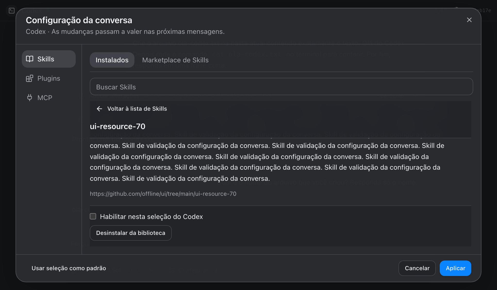

# Harness isolation, Skill navigation and derived MCP regression

Follow-up to the user review on 2026-11-02, draft PR #33. Base: `90bafdb`.

Confirmed scope: portable installs stay shared; selections, drafts and defaults stay independent. The screenshot showed actual Codex system/local roots and the shared `.agents/skills` root, whose ownership was not clear in the UI.

- Stale inventory and foreign-harness/archive regressions observed RED, then fixed. Origin labels now identify the harness and shared directories.
- Detail/install/uninstall/back regressions observed RED, then fixed. The single scroll owner restores list position and keyboard focus; Back and actions remain visible. Shared removal requires confirmation. Native CLI files and existing conversation snapshots are retained.
- Manual Skill removal accepts only registered Ptolemy IDs. Stored harness choices are not rewritten; missing resources remain availability-checked.
- The real CLI reproduced `invalid transport in mcp_servers.codex_app` when derived inventory entries received name-only disabled overrides. It passed after preserving the transport kind and generating valid disabled entries. The user's real inventory also parsed with every inherited MCP disabled under deny-network/deny-write policy; no model calls or global edits were made.

Validation: 987 unit tests /95 files passed; TypeScript, lint and complete development bundle passed. Integration26 passed/1 opt-in native vault skip; chat E2E7 passed/29 assertions with80 Skills, both agents, light/dark, deep-list detail navigation, sticky controls, restored scroll/focus and follow-up memory. Native desktop checks continue through CI.

Evidence: `/tmp/ptolemy-harness-fixes-unit-final.log`, `/tmp/ptolemy-harness-fixes-integration.log`, `/tmp/ptolemy-harness-skill-chat-e2e.log`, `/tmp/ptolemy-codex-derived-mcp-{red,green}.log`. Captures: `/tmp/ptolemy-harness-skill-screenshots/chat-{claude,codex}-skill-details.png`.

Independent scoped review found one Important issue: opening packaged Skill details before compatibility review completed could keep activation disabled. A deferred-review regression reproduced the failure and passed after detail readiness was derived from live package/revision/component capabilities. The full 987-test suite, types and bundle were rerun. No Critical or Minor findings remained; no re-review was dispatched. Review excluded original branch work (already reviewed), live services/global modifications (prohibited by this correction's scope), and native rendering (unchanged; CI is separate evidence).

