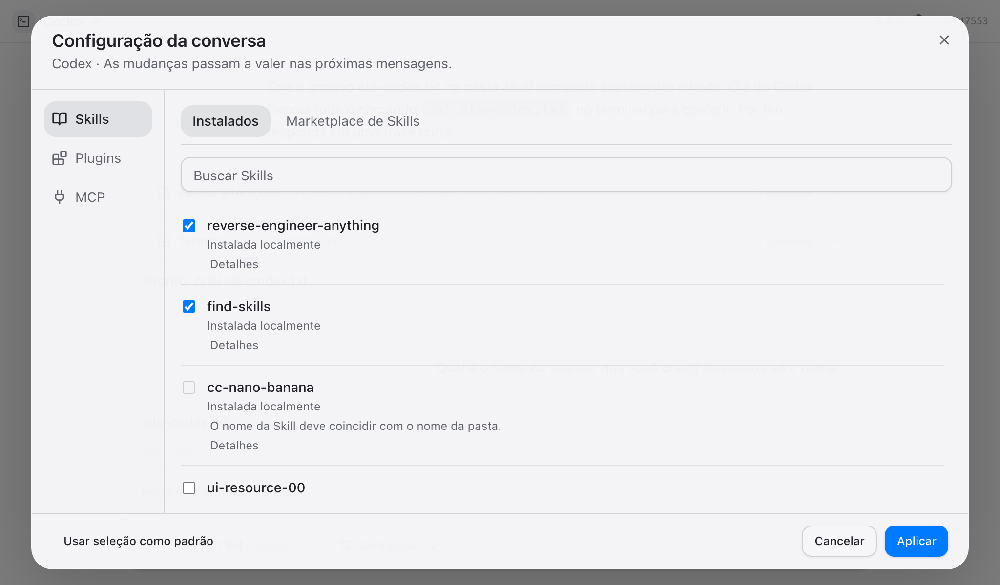
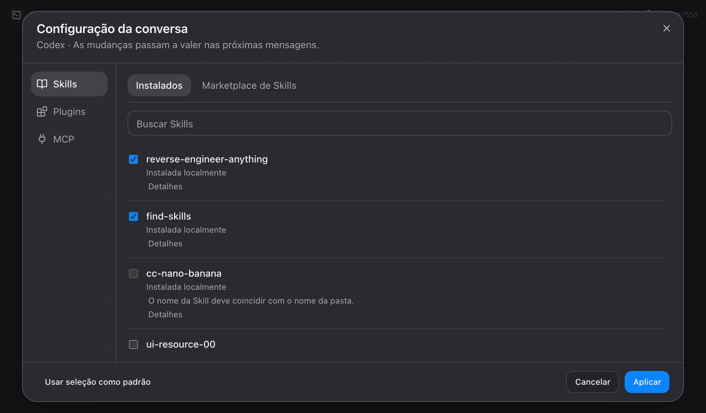

# Resource settings and native glass validation

Branch: `codex/resource-settings-glass`, based on `4bb8fc5` (`origin/main`). Draft review: [PR #33](https://github.com/guichafy/ptolemy/pull/33).

## Implemented behavior

- Preferences nest Skills, Plugins and MCP under Claude and Codex, with dedicated marketplace views.
- The compact conversation control opens a bounded summary and the shared configuration modal. Apply and Cancel are separate; saved defaults affect new conversations explicitly.
- Existing conversations can change resources between turns while retaining harness identity, history and frozen selected revisions.
- New destinations and existing generated bytes are checked before teardown. Rollback preserves unmanaged project files. Stale requests targeting a different active conversation are rejected.
- Drafts belong to a conversation, initialize after asynchronous loading, and survive ordinary library refreshes. MCP operations cannot strand the modal in a busy state.
- Resources absent from the shared library are labeled as archived in the conversation; unavailable registry actions are hidden.
- Native glass uses public AppKit APIs, falls back to vibrancy on older systems, and follows system appearance and accessibility settings.

## Final verification

- Unit tests: **977 passed**, 92 files. Coverage thresholds passed: statements 60.81%, branches 59.22%, functions 57.52%, lines 62.28%.
- Integration: **26 passed**, one opt-in native Keychain test skipped; 246 assertions. Both real CLIs run against isolated local API mocks.
- Chat E2E: **7 passed**, 21 assertions, both agents, 80 Skills, short viewport, Apply/Cancel, preserved memory and light/dark changes.
- Lint, TypeScript, native compilation, Vite and the complete development app bundle passed.
- AppKit material smoke passed for glass and forced vibrancy: one material host, content ownership, resize, idempotence and light/dark.
- Independent whole-branch review identified five material findings. All were fixed in one pass with observed failing regressions followed by passing tests. No second review was substituted for verification.

Local logs: `/tmp/ptolemy-review-final-{unit,integration,chat-e2e,types,lint,bundle}.log` and `/tmp/ptolemy-review-material-{native,fallback}.log`. Inspected screenshots: `/tmp/ptolemy-glass-chat-screenshots/chat-codex-resources-{light,dark}.png`. Development application: `build/dev-macos-arm64/ptolemy-dev.app` in this worktree.

## Web interface evidence

These Chromium captures show the shared conversation modal at a short viewport with a long inventory. They are not native desktop glass captures.

## Acceptance still required

Full native desktop visual inspection remains pending. Appium Mac2 WebDriverAgent failed before app launch; computer-use automation timed out or returned `cgWindowNotFound`. Direct development-bundle launch and the AppKit smoke succeeded. Chromium screenshots prove web layout and themes, but do not prove desktop glass clipping, multi-monitor geometry, hotkey focus or live accessibility rendering. No OS permission changes were made.

Real-account OAuth interoperability was not repeated during this UI correction. The existing OAuth protocol and local integration coverage remain in place.

## Implementation rulings

1. Durable design and plan documents use existing `docs/specs` and `docs/plans`; `docs/superpowers` is ignored. Cost if incorrect: document relocation.
2. The native helper targets macOS 14, matching the bundled Electrobun wrapper. The host SDK otherwise defaults to macOS 26. Cost if incorrect: older-system compatibility; the bundled runtime already requires 14.
3. Native desktop visual proof is deferred because local automation failed independently of the app. Cost: desktop-specific clipping and focus still need acceptance.
4. The final reviewer likewise declined to judge desktop rendering; that limitation remains explicit. Cost: the same native acceptance gap.
5. Live external OAuth was not repeated because its protocol implementation is unchanged. Cost: provider-specific behavior may differ from local mocks.

No minor review findings were deferred. The archived-origin finding was regraded Important and fixed.
